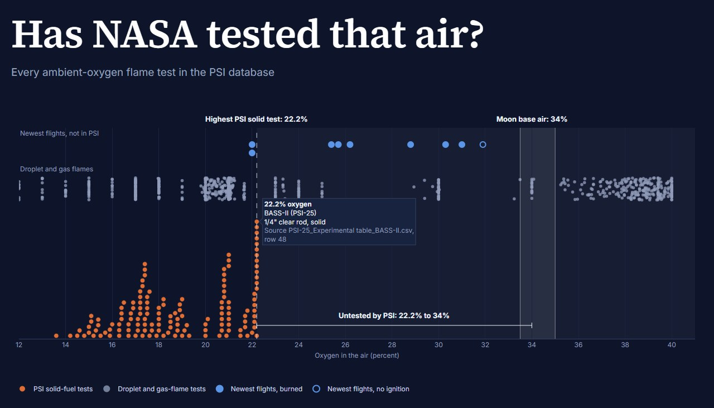
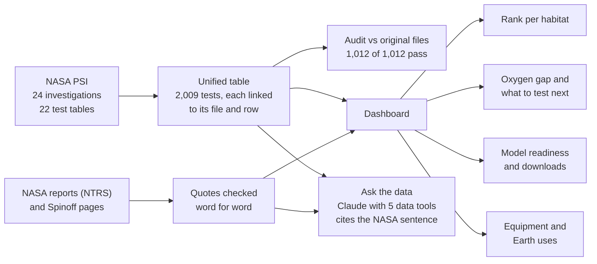

# Flame in Freefall

NASA Space Apps Challenge 2026

Challenge: Flame in Freefall: SI-Powered Fire Safety Insights from Microgravity Combustion Data

Team: Kenyalang Blue Flame (Bintulu, Malaysia)

Live dashboard: https://flame-in-freefall-three.vercel.app

## The finding

A Moon base is planned to run at about 34% oxygen. Across 2,009 NASA combustion tests in the PSI database, solid materials were never tested above 22.2% oxygen. The newest flights reached about 31%, and they are not in PSI yet. The dashboard shows that gap for five crewed habitats and what NASA should test to close it.




## How it works



## Challenge objectives

| Objective | Where in the dashboard |
|---|---|
| Identify investigations most relevant to crew habitats | Rank: five habitats, re-weightable score, rank stability per row |
| Extract data for predictive modelling | Data: where a model can be trusted (oxygen x pressure map), model readiness per habitat, CSV/JSON downloads |
| Research for next-generation fire safety equipment | Investigations > Equipment: prevention, detection, suppression |
| Earth applications | Investigations > On Earth: water mist, smoke detection, firefighter air tanks and clothing (NASA Spinoff, quoted) |

## Data

- NASA PSI combustion experimental tables: `data/psi_experimental_tables/` (22 CSV files, unmodified).
- Unified table: `data/unified/conditions.csv` (2,009 rows, each with its source file and row).
- Investigation metadata: `data/investigations/investigations_meta.json`.
- Habitat atmospheres with NASA sources: `data/environment_profiles.json`.
- Verified key findings and their source text: `data/findings/`.

## Reproduce

Python 3.12, standard library (Pillow for images; numpy and scipy for the model in `build_models.py`).

```
py -3.12 pipeline/build_unified.py
py -3.12 pipeline/build_site_data.py
py -3.12 pipeline/verify_findings.py
py -3.12 pipeline/audit_unified.py
py -3.12 pipeline/verify_earth.py
py -3.12 pipeline/build_models.py
py -3.12 -m unittest discover -s tests
```

The site in `public/` is static. The Ask function is `api/ask.py` (Vercel Python runtime) and needs `ANTHROPIC_API_KEY`.

## Verification

- Every quoted finding is checked word for word against its NASA source text (`pipeline/verify_findings.py`, `pipeline/verify_earth.py`).
- The unified table is re-checked against the original PSI files (`pipeline/audit_unified.py`).
- Habitat values are either cited to a NASA source or shown as not specified; nothing is assumed.

## Use of Super Intelligence (SI)

SI (Claude, Anthropic) was used to help research the challenge and data sources, write and test code, extract candidate quotes from NASA reports, and draft text. Quotes are machine-checked against their sources and all data processing is plain code with automated tests. The Ask panel uses Claude restricted to the loaded NASA documents. No SI-generated images are used. Video narration, if present, is an SI-generated voice and is labelled as such.


## License

Apache License 2.0, see `LICENSE`. NASA data and documents remain under their own terms as stated on each PSI and NTRS record.
