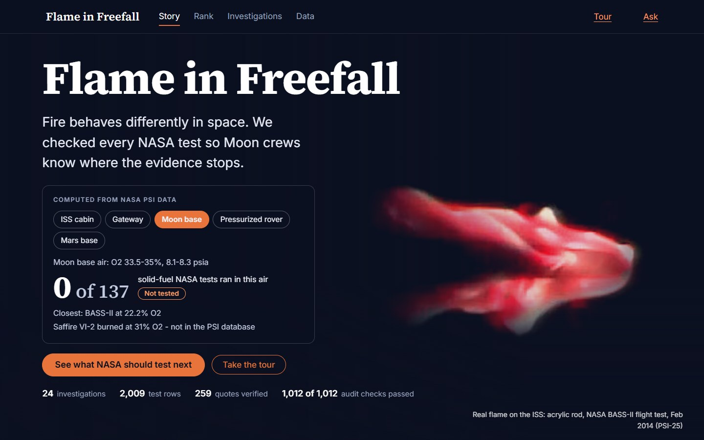
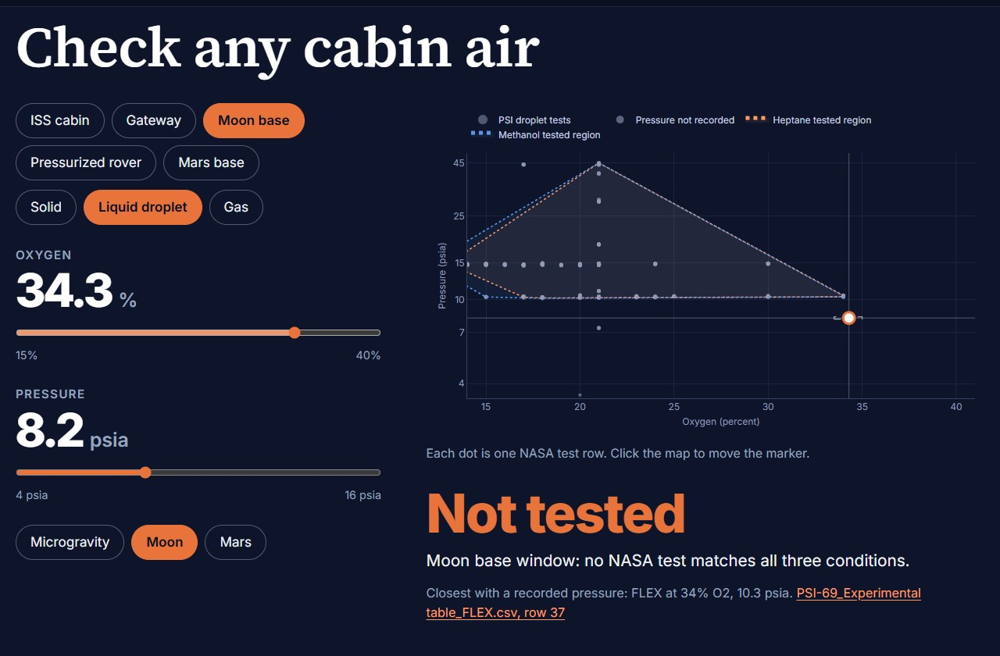
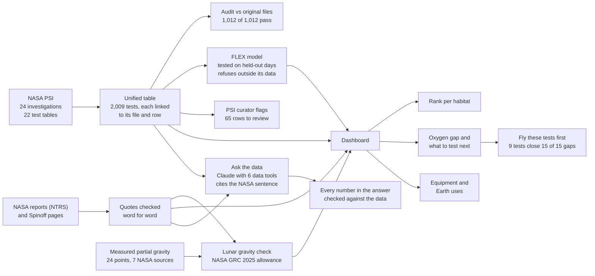

# Flame in Freefall

NASA Space Apps Challenge 2026

Challenge: Flame in Freefall: SI-Powered Fire Safety Insights from Microgravity Combustion Data

Team: Kenyalang Blue Flame (Bintulu, Malaysia)

Live dashboard: https://flame-in-freefall-three.vercel.app

Demo video (30 s): https://youtu.be/q3KyZFqHhr4

## Judge it in 3 minutes

1. Story page, the oxygen gap chart: hover a dot to see its source file and row. https://flame-in-freefall-three.vercel.app/#/home
2. Check any cabin air: pick Moon base. It shows Not tested and the model refuses to guess. https://flame-in-freefall-three.vercel.app/#/home?at=s-next
3. Rank, Fly these tests first: the test plan and its CSV. https://flame-in-freefall-three.vercel.app/#/rank?habitat=lunar&at=test-plan
4. Gravity page: the measured lunar and Martian limits, each with its source quote. https://flame-in-freefall-three.vercel.app/#/gravity
5. Ask: ask a question and see the citations and the numbers check. Open it from the Ask button in the header.

## The finding

A Moon base is planned to run at about 34% oxygen. Across 2,009 NASA combustion tests in the PSI database, solid materials were never tested above 22.2% oxygen. The newest flights reached about 31%, and they are not in PSI yet. The dashboard shows that gap for five crewed habitats and what NASA should test to close it.






## How it works



## What sets it apart

- **One gesture shows it all.** Drag a cabin's oxygen and pressure, or pick a habitat: the card counts the NASA tests in that air, names the closest one with its source row, runs the FLEX model or refuses with the distance, and adds the lunar gravity allowance. Every state has its own link.
- **It knows where the evidence stops.** The model refuses habitats outside the tested range and says by how much. Moon base air is 0.14 atm below any FLEX test.
- **Gravity, not just oxygen.** The lunar gravity check uses NASA Glenn's 2025 lunar-g tests: NASA Glenn's allowance for six materials is up to 2.3 O2 points, drop tests measured larger drops for some (Mylar 21.2 to 15.6, 5.6 points, at 10.2 psia), and some materials went the other way. A chart of 24 quote-checked partial-gravity points from 7 NASA sources sits below it.
- **The newest flights, as data.** The 9 Saffire IV-VI flight tests that are not in PSI yet are rows in the app, each tied to a verbatim quote from its NASA report. Six burned solids between 25.4% and 31.0% oxygen, above PSI's 22.2% ceiling.
- **A short test list, not just a gap.** Rank > Fly these tests first picks the fewest test conditions that close every habitat gap (a habitat x fuel class with no PSI test inside its window): 9 tests close 15 of 15. Test 1 is one solid-material test at 33.5-35% O2 and 8.1-8.3 psia that covers the Moon base, Mars base and pressurized rover at once. Downloadable as a CSV test matrix.
- **Flags for the PSI team.** Data > For PSI curators lists 65 rows flagged by fixed rules (43 repeated rows, 11 text in number columns, 8 negative airflow, 2 oxygen on the wrong scale, 1 impossible pressure), each linked to its file and row. They are flagged, not confirmed errors. The same scan caught a sign error in our own parser, now fixed.
- **Checked, not just cited.** Each Ask answer shows how many of its numbers match NASA data or the cited NASA sentence. Quotes on every page are machine-checked against saved source text.

## Challenge objectives

| Objective | Where in the dashboard |
|---|---|
| Identify investigations most relevant to crew habitats | Rank: five habitats, re-weightable score, rank stability per row. Home: Check any cabin air for any oxygen and pressure |
| Inform next-generation fire safety | Rank > Fly these tests first: 9 tests close 15 of 15 habitat gaps, with a CSV test matrix |
| Extract data for predictive modelling | Data: a FLEX droplet model tested on held-out test days (AUC 0.85, Brier skill +0.35) that predicts for ISS air and refuses Moon air; where a model can be trusted (oxygen x pressure map); model readiness per habitat; CSV/JSON downloads. Data > For PSI curators: 65 flagged rows linked to their source file and row |
| Partial gravity (lunar habitat) | Data > Lunar gravity check: NASA GRC allowance per material (up to 2.3 O2 points, not a maximum), measured lunar and Martian limits, quenching vs blowoff |
| Research for next-generation fire safety equipment | Investigations > Equipment: prevention, detection, suppression |
| Earth applications | Investigations > On Earth: water mist, smoke detection, firefighter air tanks and clothing (NASA Spinoff, quoted) |

## Data

- NASA PSI combustion experimental tables: `data/psi_experimental_tables/` (22 CSV files, unmodified).
- Unified table: `data/unified/conditions.csv` (2,009 rows, each with its source file and row).
- Investigation metadata: `data/investigations/investigations_meta.json`.
- Habitat atmospheres with NASA sources: `data/environment_profiles.json`.
- Verified key findings and their source text: `data/findings/`.
- Measured partial-gravity points with source text: `data/partial_g/`.
- Saffire IV-VI rows and NASA-report solid pressures: `data/outside_psi/`.
- Test plan: `public/data/test_plan.json` (built by `pipeline/test_plan.py` through `build_site_data.py`).
- PSI curator flags: `public/data/data_health.json` (built by `pipeline/data_health.py`).

## Reproduce

Python 3.12, standard library (Pillow for images; numpy and scipy for the model in `build_models.py`).

```
py -3.12 pipeline/build_unified.py
py -3.12 pipeline/build_site_data.py
py -3.12 pipeline/verify_findings.py
py -3.12 pipeline/audit_unified.py
py -3.12 pipeline/verify_earth.py
py -3.12 pipeline/verify_lunar_g.py
py -3.12 pipeline/verify_outside_psi.py
py -3.12 pipeline/verify_partial_g.py
py -3.12 pipeline/data_health.py
py -3.12 pipeline/build_models.py
py -3.12 -m unittest discover -s tests
```

The site in `public/` is static. The Ask function is `api/ask.py` (Vercel Python runtime) and needs `ANTHROPIC_API_KEY`.

## Verification

- Accessibility: Lighthouse accessibility 100 on the Story, Rank, Investigations, Data, Gravity and Verification pages; axe-core 4.10 reports no violations after a full-page scroll. Every chart has a text alternative and every control works from the keyboard.
- Every quoted finding is checked word for word against its NASA source text (`pipeline/verify_findings.py`, `pipeline/verify_earth.py`, `pipeline/verify_lunar_g.py`), and the Saffire IV-VI rows and sourced solid pressures against their NTRS reports (`pipeline/verify_outside_psi.py`, 57 of 57 quotes). The partial-gravity points are checked the same way (`pipeline/verify_partial_g.py`): 152 quotes and 116 numbers against saved source text in `data/partial_g/`.
- 259 quotes in total are checked word for word: 39 key findings, 57 outside PSI, 9 lunar gravity, 2 Earth uses and 152 partial gravity.
- `pipeline/data_health.py` flags 65 PSI rows by fixed rules for curator review. The scan also found 8 negative airflows in PSI-107 SPICE that our parser had read as positive; fixed and covered by tests in `tests/test_build_unified.py`.
- The unified table is re-checked against the original PSI files (`pipeline/audit_unified.py`).
- Habitat values are either cited to a NASA source or shown as not specified; nothing is assumed.
- The Ask assistant was scored on 100 questions whose checks were committed before the run (`eval/ask_eval_set_v2.json`, `eval/run_ask_eval_v2.py`, results in `eval/results/`): 94 passed, all 25 trap questions were refused, 98.2% of the numbers in answers matched the data, with the failures listed on the Verification page.

## Use of Super Intelligence (SI)

SI (Claude, Anthropic) was used to help research the challenge and data sources, write and test code, extract candidate quotes from NASA reports, and draft text. Quotes are machine-checked against their sources and all data processing is plain code with automated tests. The Ask panel uses Claude restricted to the loaded NASA documents. The demo video's narration voice (Microsoft Edge neural TTS) and music (ACE-Step 1.5) are AI-generated and labelled on screen. No AI-generated images or video are used; flame footage is real NASA BASS-II flight video.


## License

Apache License 2.0, see `LICENSE`. NASA data and documents remain under their own terms as stated on each PSI and NTRS record.
